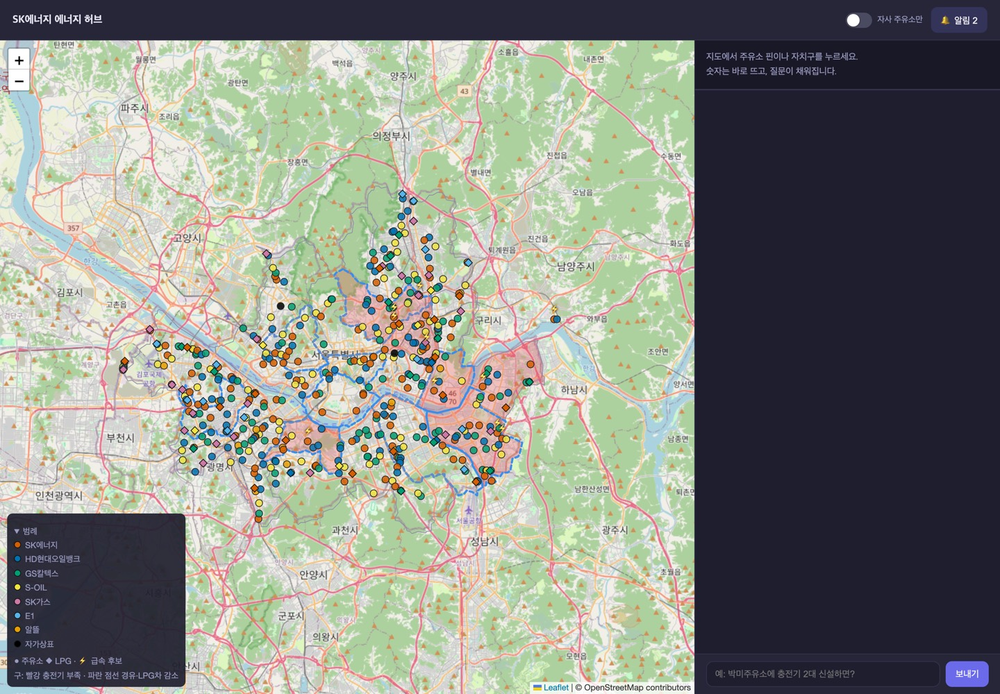
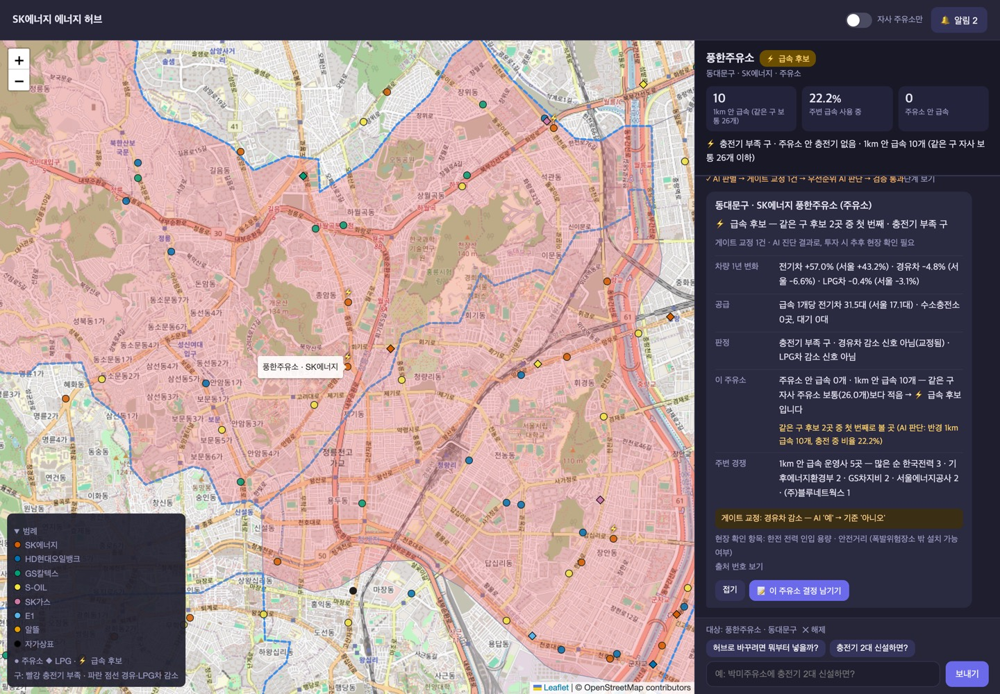
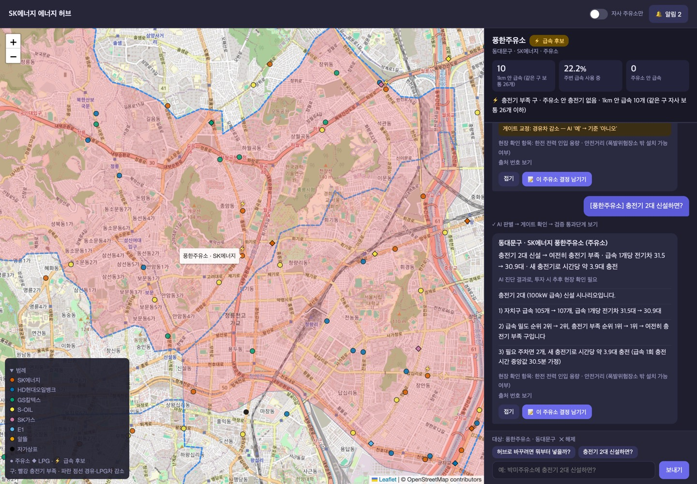
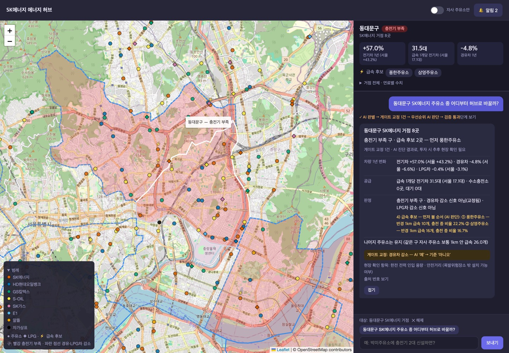
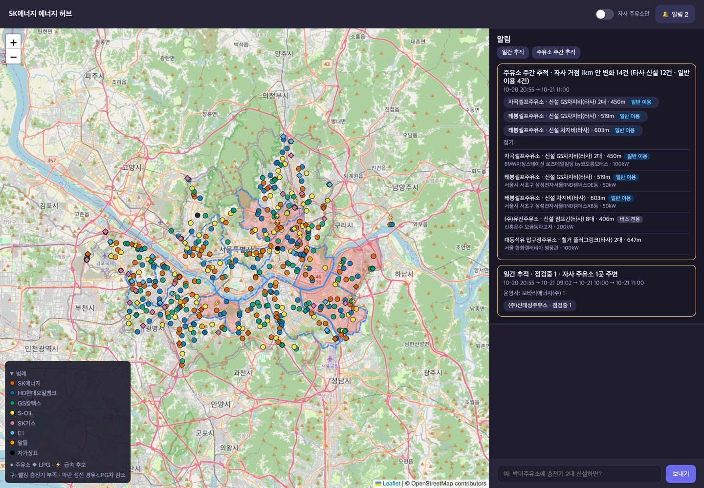

# 주유소 복합 에너지 허브 전환 Agent

SK에너지 서울 주유소에 **어떤 에너지(전기·수소 등)를 어디에 더할지** 공공 실데이터로 판단하는 멀티 에이전트 서비스와 관리자 대시보드.



## 1. 주제 선정 배경

- 서울 1년 변화(2025.9 → 2026.9): 경유차 **−6.6%**, 전기차 **+43.2%** — 주유소가 갖출 에너지 구성이 지역마다 달라짐
- SK에너지 서울 주유소 114곳 중 주유소 안 충전기가 있는 곳은 **8곳**
- 충전 사업은 가동률이 수익을 가름 → 어느 주유소에 무엇을 넣을지 데이터로 판단 필요

## 2. 해결하려는 문제

- 대상: 서울 25개 자치구, 주유소 397곳 + LPG 충전소 73곳 (SK에너지 130곳)
- 연료: 휘발유 · 경유 · LPG · 전기 · 수소
- 사용자: 리테일 네트워크 관리자, 투자 검토 담당자
- 문제: 수급 데이터가 여러 기관에 흩어져 있음, 충전기 신설 위치를 정할 자료 부족, 고장 충전기를 늦게 파악
- 원칙: 실데이터만 사용, 판별은 LLM · 최종 판정은 코드, 결정은 사람

## 3. 주요 기능

| 기능 | 내용 |
|---|---|
| 주유소 진단 | 급속충전 후보 판정과 이유, 반경 1km 급속충전기·경쟁 운영사 |
| 자치구 진단 | 충전기 부족, 경유·LPG차 감소 신호, 자사 주유소 묶음 |
| 우선순위 판단 | 급속 후보가 2곳 이상이면 AI가 먼저 볼 곳과 이유를 판단, 코드는 후보·인용 사실·숫자만 검사 |
| 신설 시나리오 | "충전기 N대 신설하면?" 지표 변화 계산 |
| 이름 찾기 | 같은 이름 주유소가 여러 곳이면 되묻기 |
| 일간 추적 | 자사 주유소 1km 안 급속충전기가 직전 수집 정상에서 3회 연속 고장으로 바뀌면 멈춘 이유별 알림 |
| 주간 추적 | 자사 주유소 1km 안 급속충전기 신설·철거 보고, 새 충전기는 일반 이용·버스 전용 구분 |
| 대시보드 | 지도(470곳 핀, 자치구 신호), 정보 패널, 채팅, 알림함 |

## 4. 실행 화면

**주유소 진단** — 핀 클릭 → 정보 패널, 질문 → 요약 한 줄 + 항목별 상세, 코드 교정 표시



**충전기 신설 시나리오** — 신설 전후 급속 1개당 전기차, 충전기 부족 순위, 시간당 충전 대수



**자치구 진단과 우선순위** — 구 클릭 → 급속 후보 중 먼저 볼 순서를 AI가 판단



**알림함** — 일간 추적(멈춘 이유별), 주간 추적(새 충전기 일반 이용·버스 전용 구분)



## 5. 시스템 구조

```
질문 → 요청 분류 → MCP Tool 병렬 조회 → LLM 판별
     → 코드 기준과 비교 (다르면 교정) → 답변 작성
     → 숫자·인용 검증 (불합격 시 1회 재작성) → SSE로 화면 표시
```

- 일간·주간 추적은 코드가 먼저 변화 감지, 변화 없으면 LLM 호출 없음
- 사람의 결정은 `POST /api/decisions`로 저장, 에이전트는 읽기만 함

### 사용 데이터

| 데이터 | 출처 |
|---|---|
| 자치구별 연료별 자동차 등록 (2025.9, 2026.9) | 서울 열린데이터광장 |
| 자동차 등록 통계 (교차 검증·확장용) | 국토교통 통계누리 |
| 전기차 등록대수 (교차 검증·확장용) | 한국교통안전공단 (공공데이터포털) |
| 충전기 위치·상태 | 한국환경공단 API (공공데이터포털) |
| 수소충전소 대기 차량 | 한국석유관리원 API (공공데이터포털) |
| 주유소·LPG 충전소 위치 | 오피넷 API |

- 외부 API는 수집 스크립트(`data_prep/collect.py`)에서만 호출
- 서비스는 `data/snapshots/` 스냅샷만 읽음 (mock 데이터 없음)
- 파일별 출처·기준일: [data/README.md](data/README.md)

### 기술 스택

- 백엔드: FastAPI, LangGraph, FastMCP, SSE, SQLite
- 프론트: Vue 3, Leaflet (CDN)
- LLM: fake(규칙 기반) / Ollama(qwen3:0.6b·8b) / OpenAI(gpt-4o-mini·gpt-4o)
- 추적: LangSmith

## 6. 실행 방법

```bash
bash sh/setup_venv.sh        # 처음 한 번 (.venv 생성, 패키지 설치)
cp .env.example .env         # LangSmith·OpenAI 키 입력 (fake 모드는 없어도 됨)
bash sh/run_agent_fake.sh    # 백엔드 :8100
bash sh/run_frontend.sh      # 대시보드 :8600 (새 터미널)
```

- 접속: http://localhost:8600

| LLM | 실행 명령 | 비용 |
|---|---|---|
| fake (같은 질문에 항상 같은 답) | `bash sh/run_agent_fake.sh` | 없음 |
| Ollama (로컬) | `bash sh/setup_ollama.sh` 후 `bash sh/run_agent_ollma.sh` | 없음 |
| OpenAI | `bash sh/run_agent_openai.sh` | 과금 |

- fake 모드는 경유차 감소를 일부러 1건 틀리게 판별 → 코드가 교정하는 과정 확인용

## 7. 테스트 결과

### 단위·흐름 테스트

```bash
.venv/bin/python3 -m pytest -q
```

- 결과: **112개 전부 통과** (2026-10-21, 약 43초)
- 실데이터 스냅샷 사용 (기대값이 흔들리지 않게 10-21 9시 수집까지로 고정)
- 범위: 판정 규칙, MCP Tool, 그래프 흐름, API, 일간·주간 추적, 결정 저장

### 평가 질문 18개

```bash
LANGCHAIN_TRACING_V2=false .venv/bin/python3 eval/run_eval.py ollama
```

- 질문 종류: 주유소 진단, 자치구 묶음, 시나리오, 이름 찾기, 타사 주유소, 재계획
- 정답 숫자는 에이전트를 거치지 않고 스냅샷에서 직접 계산

| 지표 | Ollama 개선 전 | Ollama 최신 |
|---|---|---|
| 데이터에 없는 숫자 | 0 / 281 | 0 / 300 |
| 정답 숫자 포함 | 31/31 | 31/31 |
| LLM 판별 일치율 (교정 전) | 53.7% | 85.2% |
| 검증 합격 | 18/18 | 18/18 |
| 요청 분류 정답 | 17/18 | 18/18 |
| 우선순위 AI 판단 채택 · 3회 반복 같은 순서 | - | 4/4 · 2/2 |
| 응답 시간 중앙값 | 68초 | 79초 |

- Ollama 모델: 분류·검증 qwen3:0.6b, 판별·작성 qwen3:8b
- 개선 내용: 분석 에이전트에 빠진 순위 정보 추가, 순위 읽는 법 프롬프트에 명시, 판별·우선순위 판단에 생각 모드 사용
- 일치율이 100%가 아니어도 최종 판정은 코드 기준으로 교정 후 확정
- 질문별 결과: [eval/results_ollama.md](eval/results_ollama.md), [개선 전](eval/results_ollama_baseline.md)

## 8. 폴더 구조

```
server.py            FastAPI (채팅 SSE, 대시보드 API, 상시 작업)
mcp_server.py        MCP 서버 (에이전트와 대시보드가 같이 사용)
agent/               LangGraph 그래프·노드, LLM 어댑터, 검증, 이력 저장
energy/              스냅샷 로드, 지표 계산, 판정 규칙·기준값
web_chat.html        지도 + 정보 패널 + 채팅
web_demo_server.py   대시보드 화면 서버 (:8600, 백엔드로 중계)
sh/                  설치·실행 스크립트
data/ · data_prep/   실데이터 스냅샷, 수집·정리 스크립트
tests/ · eval/       테스트, 평가 스크립트와 결과
assets/              README 화면 캡처
```

## 9. 한계와 향후 개선

### 한계

- 판매량·재고, 부지 적합성, 투자 수익 예측, 서울 외 지역은 분석하지 않음 (공개 데이터 없음)
- 전력 용량·안전거리는 현장 확인 항목으로 사람에게 넘김

### 향후 발전 방향

- 진단 범위 확장: 전기·수소 충전에 더해 충전 대기 시간 동안 이용할 휴식·편의시설 배치까지 판단
- 데이터·AI 운영: 수요 변화·충전기 상태 진단을 운영 효율화로 확장
- 고객 경험: 앱으로 충전 대기·고장 안내, 예약 연결
- 주유소를 연료만 넣는 곳이 아닌 일상 생활 플랫폼으로 전환
